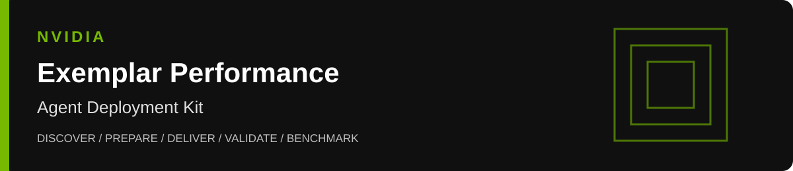
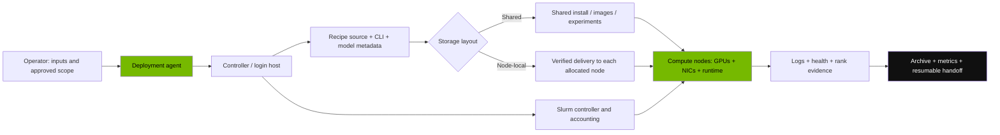
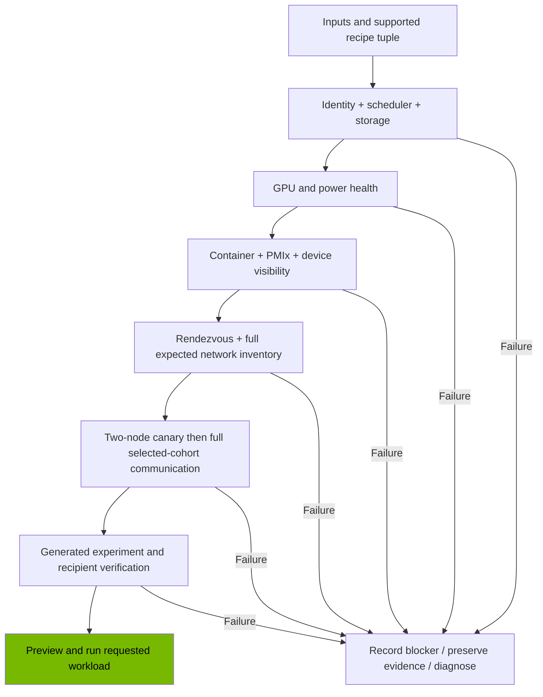
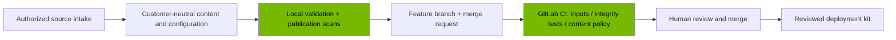

<p align="center"></p>

# NVIDIA Exemplar Performance · Agent Deployment Kit

**Give this repository to an agent to prepare a supported GPU cluster, obtain the required software, validate the system, and run reproducible NVIDIA Exemplar Performance recipes.** Deployment inputs belong in a private local configuration; this repository contains no customer inventory, credentials, completed-job examples, or fleet-specific operating scripts.

This kit orchestrates an installation through documented agent instructions and preparation tools. The official [NVIDIA Exemplar Performance repository](https://github.com/NVIDIA/exemplar-performance) supplies the workload implementations, installer, supported hardware/scale combinations, and benchmarking CLI. The agent must obtain and pin those sources; they are not bundled here. Infrastructure configuration depends on the target platform and requires the operator's approved installation method.

> **Portability boundary:** the procedure is customer-neutral. A chosen recipe must support the actual GPU type, CPU architecture, scheduler, precision, and GPU scale. This runbook implements the Slurm + Enroot + Pyxis route. An unsupported platform or scheduler requires an explicitly reviewed adapter; changing a GPU count does not make a recipe supported.

[Agent handoff](agent_exemplar_skills.md) · [Execution runbook](run_exemplar.md) · [Cluster inputs](config/cluster.example.json) · [Air-gap delivery](docs/airgap.md) · [Acceptance and recovery](docs/acceptance.md) · [Factory workflow](docs/factory.md)

## 1. What the agent should accomplish

The agent owns the complete preparation sequence within the operator's authorized scope:

1. Discover the controller, compute nodes, scheduler, GPU/network topology, storage, and existing installations.
2. Collect missing non-secret deployment inputs and ask the operator to provision Hugging Face and registry credentials through a secure local channel.
3. Select a compatible, immutable upstream source revision and the desired workload/model/precision/scale matrix.
4. Prepare the operating-system dependencies, GPU/RDMA stack, Slurm integration, container runtime, model metadata cache, and workload environment using approved platform procedures.
5. Download containers and dependencies directly when permitted, or build and verify an offline delivery payload on a connected staging system.
6. Install and verify matching payloads across the intended nodes, including generated experiment files on systems with node-local storage.
7. Validate GPU, scheduler, container, storage, rendezvous, and communication health with current evidence.
8. Preview the requested recipe, submit only the intended allocation, monitor actual progress, retain results, and produce a durable agent handoff.

A completed download, successful integrity check, or scheduler exit code is one piece of evidence. Overall acceptance requires the checks in [the acceptance guide](docs/acceptance.md). Performance qualification additionally requires the exact supported suite, scale, scoring procedure, and appropriate NVIDIA baseline/review.

## 2. Start here: give this instruction to the agent

Copy the following instruction into the agent running in the approved deployment environment. The operator chooses whether the scope includes job submission or preparation only.

```text
Read README.md, AGENTS.md, agent_exemplar_skills.md, run_exemplar.md,
docs/airgap.md, and docs/acceptance.md in this repository.

Prepare this cluster to run the NVIDIA Exemplar Performance recipes.
Use config/cluster.example.json as the input checklist and create the filled
configuration outside Git. Discover existing services and active jobs first.
Ask me for missing cluster inputs together. Ask me to provision a Hugging Face
token and NGC access in secure local credential files; do not request token
values in chat or place them in configuration, commands, logs, or artifacts.

Network mode: <CONNECTED_OR_AIRGAP>
Deployment scope: <PREPARE_ONLY_OR_PREPARE_AND_RUN>
Target GPU/architecture: <GPU_TYPE_AND_CPU_ARCHITECTURE>
Requested workloads/model sizes/precisions/GPU scales: <WORKLOAD_MATRIX>
Approved installation and maintenance scope: <SCOPE>

Use the official pinned recipe and its installed CLI help. Complete discovery,
prerequisites, software delivery, installation, and live validation. Keep a
checkpoint and evidence index. If execution is in scope, run only the validated
workload matrix and archive all outputs. If blocked, identify the exact missing
input and continue independent authorized work. Report what was measured,
what remains unverified, and how the next agent can resume.
```

The entry document is a portable agent instruction, not an automatically installed plugin. Agents should read it explicitly. `AGENTS.md` provides routing and repository rules; `agent_exemplar_skills.md` provides the deployment phase contract.

### First five actions

1. Clone or transfer this kit into the approved controller workspace.
2. Read the linked handoff and execution documents before changing services.
3. Copy `config/cluster.example.json` to `config/cluster.local.json` or an access-controlled workspace outside the repository.
4. Replace every placeholder, including integer `null` values. Use secret **file references**, never secret values.
5. Validate inputs locally:

```bash
python3 tools/prepare.py validate-config config/cluster.local.json
```

This command checks structure, explicit hostnames, immutable upstream commit, credential reference shape, and whole-node GPU allocation arithmetic. It performs no network probes, reads no secret files, installs nothing, and submits no jobs. `INPUTS_VALID` means the inputs are structurally complete; the agent must still validate upstream recipe support and live cluster readiness.

## 3. Architecture



| Role | Required responsibilities | Placement |
| --- | --- | --- |
| Operator | Inventory, access, licenses, deployment scope, workload goals | Approved secure channel |
| Agent workspace | Discovery, installation plan, checkpoint, verification receipts | Controller or approved management host |
| Controller / login host | Official CLI, workload installation, scheduler access, evidence collection | Approved management plane |
| Slurm services | Scheduling, authentication, GPU allocation, optional accounting | Existing cluster or approved new installation |
| Compute nodes | Host driver, GPU devices, fabric, Enroot/Pyxis, workload mounts and runtime | Selected explicit node cohort |
| Connected staging host | Licensed downloads, pinned source/dependency closure, offline payload | Required when target has no download access |
| Artifact store | Containers, cache, package closure, source manifests | Shared storage, internal registry, or authorized transfer medium |
| Evidence store | Timestamped checks, configurations, logs, hashes, final state | Persistent controlled storage outside Git |

The controller and staging host can be the same machine if policy permits. Compute nodes do not need internet access when all required artifacts are staged. The deployment agent itself must have an approved execution path into the target; air-gapped targets may require an agent runtime/model service installed inside that boundary or an approved management connection.

## 4. Inputs the agent must collect

Use aliases in reports intended for sharing. Actual hostnames, addresses, and storage locations stay in the private deployment configuration and access-controlled evidence.

| Input | Placeholder / field | Why it matters |
| --- | --- | --- |
| Cluster alias | `<CLUSTER_ALIAS>` | Identifies an isolated campaign without naming an organization |
| Network mode | `connected` or `airgap` | Determines direct download versus staged delivery |
| CPU architecture | `x86_64` or `aarch64` | Must match containers, packages, Python wheels, and native extensions |
| GPU type | `<UPSTREAM_GPU_TYPE>` | Selects supported official workload configurations |
| GPUs per node | Positive integer | Determines scheduler requests and total scale |
| Explicit nodes | Unique hostname list | Defines intended allocation and delivery recipients |
| Transport | InfiniBand, RoCE, EFA, or explicitly approved socket diagnostic | Determines platform-specific communication checks |
| HCA inventory | Expected count plus reviewed per-node device/port inventory | Avoids silently losing intended network bandwidth |
| Rendezvous interface | `<MANAGEMENT_OR_RENDEZVOUS_INTERFACE>` | Establishes routable coordination between ranks |
| Scheduler | Slurm account, partition, optional QoS, operator user | Prevents wrong queue/account allocations |
| Storage | Source, install, image, HF cache, evidence roots; shared or node-local | Controls mounts, delivery, generated files, and log collection |
| Release | Approved release identifier and full Git commit | Makes source selection reproducible |
| Workload matrix | Workload, model size, dtype, GPU scale, repeats, purpose | Prevents implicit fleet-sized submissions |
| Credentials | Secure HF token and Enroot registry credential file paths | Grants downloads without embedding credentials |
| Maintenance scope | Existing/new scheduler, runtime installation rights, driver changes, restart window | Separates preparation from platform changes requiring a maintenance plan |
| Health evidence | Available GPU, NIC/fabric, power, scheduler, and storage telemetry | Establishes current readiness with platform-appropriate coverage |
| Result destination | Approved archive path and retention/sharing policy | Keeps results recoverable and within the intended audience |

The JSON file is **this kit's deployment input format**, not the upstream `cluster_config.yaml` schema. Use the official installer to generate its release-specific configuration, then reconcile it with these inputs. Do not feed this JSON directly to `llmb-run`.

## 5. Prerequisites and responsibility matrix

### Software baseline

The public [upstream prerequisite list](https://github.com/NVIDIA/exemplar-performance#prerequisites) gives these general floors: Bash 4.2, Python 3.12.x, Git LFS, NGC access, CUDA 12.3, NVIDIA driver 535.129.03, OFED 5.9, NCCL 2.19.4, Slurm 22.x with affinity and PMIx, and Enroot 4.0 with Pyxis and required extra hooks. Check the pinned release for current requirements.

These floors are not a compatibility prescription for every GPU. Determine the approved driver, CUDA container, RDMA/libfabric stack, and runtime combination for the exact platform. EFA uses its platform-specific libfabric/provider route; do not install an InfiniBand/RoCE stack simply because it appears in a general checklist.

| Layer | Required checks | Agent preparation task | Acceptance evidence |
| --- | --- | --- | --- |
| Identity/access | Approved login, stable UID/GID, trusted host keys, intended privilege scope | Establish approved operator access and verify permissions | Successful authenticated access without bypassing host verification |
| OS/architecture | Supported Linux distribution, CPU architecture, kernel, package tooling, time synchronization | Install approved dependency closure; record versions | Version manifest and aligned timestamps |
| GPU platform | Correct devices/count, supported host driver, topology/NVLink where applicable, error state | Use approved platform provisioning; reconcile deviations | GPU inventory, topology, health and container visibility |
| Scheduler | Slurm control/node services, Munge where used, account/partition/QoS, GRES, affinity, PMIx | Configure through the owner's supported deployment system | Idle intended nodes, correct GPU allocations, successful PMIx smoke test |
| Runtime | Enroot, Pyxis, SPANK configuration, required distributed hooks, GPU/RDMA device exposure | Install matching versions and configure mounts/cache/runtime policy | Container startup and distributed launch evidence |
| Software tooling | Python 3.12 environment, Git/LFS on installation host, compatible `uv` where required | Provide connected or offline toolchain | Installer and CLI help execute from the intended environment |
| Storage | Persistent capacity, cache/extraction scratch, permissions, inodes, mount consistency | Create approved directories and per-node staging design | Free space/inode checks, write/access checks, recipient manifests |
| Network | Routable rendezvous, DNS/time, expected devices/ports, healthy fabric | Validate approved transport configuration and container propagation | Live device inventory and full-cohort collective test |
| Model access | HF account/token, repository-specific gated access, exact metadata revision | Provision secret reference and materialize required model files | Authorized download and offline cache test where needed |
| Container access | Entitled NGC credentials, pinned registry source/digest, correct architecture | Import required image and record image provenance | Source digest plus transferred `.sqsh` SHA-256 |
| Monitoring | GPU/errors/power/temperature; fabric and PSU evidence where available/required | Use existing telemetry or implement reviewed equivalent checks | Fresh coverage for all selected nodes; gaps explicitly addressed |

### Storage planning

Upstream recommends at least **300 GB** for a typical Exemplar/pretraining installation. Size the actual deployment from image sizes, temporary layer extraction, container rootfs, Python environments, HF cache, datasets/checkpoints when required, experiment staging, and retained logs/profiles. Containers can require substantially more temporary space than their final compressed files.

For node-local installs, capacity must be sufficient **on every participating node**. Controller capacity alone is insufficient. Profiling and non-pretraining workloads can add large datasets/checkpoints; estimate them from the chosen recipes. Keep evidence persistent even if compute OS roots are disposable.

### Platform differences that must remain configurable

- Do not prescribe a GPU count, rail count, HCA names, GID index, traffic class, service level, interface name, or rendezvous address globally.
- Derive InfiniBand versus RoCE versus EFA configuration from measured topology and the approved platform guide.
- Apply NVLink/NVSwitch/IMEX checks only to platforms that require them.
- Obtain health coverage through the installed monitoring system or equivalent explicit checks. No particular telemetry port or metric name is assumed by this kit.
- NVIS P2P or another distribution system is optional. Shared storage, internal registries, secure copies, and controlled removable-media transfers are valid when verified.

## 6. Hugging Face and registry credentials

### Required operator prompt

The agent should ask this at the input stage, before invoking the installer:

> **Please provision a Hugging Face read token with access to the selected model repositories in `<HF_TOKEN_FILE>`, owned by the operator and readable only by that account. Request and accept any gated-model access first. Also provision NGC registry access in `<ENROOT_CREDENTIALS_FILE>` using your approved secret mechanism. Confirm the file paths and access status here; do not paste token or API-key values into chat.**

A token alone does not grant access to a gated repository. An air-gapped deployment still needs authorized model access on the connected download host, even when the target itself never receives the token.

| Item | Provisioning | Use | Exclude from |
| --- | --- | --- | --- |
| HF token | Secret manager or local restricted file, normally mode `0600` | Authenticated metadata/tokenizer retrieval | Git, prompts, generated batch scripts, logs, offline payload |
| NGC access | Approved Enroot credential file or runtime credential provider | Licensed container download | Git, tarballs, CI variables for untrusted branches, transcripts |
| SSH identity | Approved agent/key provisioning | Management/staging access | Repository and application artifacts |
| Scheduler secret | Existing secure cluster deployment system | Slurm authentication where applicable | Recipe payloads and result archives |

Use the installed tool's supported secret input mechanism. If a release needs `HF_TOKEN` in its process environment, a local wrapper may read the approved file without printing it and pass it only to that process. Disable command tracing, avoid shell-history values, and inspect whether the installer persists secrets in `cluster_config.yaml`, system configuration, or generated scripts. Remove credential values from any output to be staged or shared; verify offline operation before removing credentials needed for online retrieval.

For standard pretraining, many recipes need model configuration and tokenizers rather than pretrained weight tensors. Other workloads may need weights or datasets. Inspect each selected recipe and obtain its exact requirements; do not download all weights by default or assume no data is needed.

See [Hugging Face access tokens](https://huggingface.co/docs/hub/security-tokens) and [NGC authentication](https://docs.nvidia.com/ngc/gpu-cloud/ngc-user-guide/index.html).

## 7. Connected installation

1. Pin the official source revision and materialize required LFS objects/submodules on an approved download-capable host.
2. Review the selected release's installer and workload metadata. Resolve image references and architecture before download.
3. Check that Slurm/runtime prerequisites and target directories are ready.
4. Provision HF/NGC secret references. Run the official installer from the pinned checkout.
5. Generate the upstream cluster configuration for the intended account/partition, GPU type and filesystem paths.
6. Confirm requested workloads are installed, images exist, model metadata is available, and generated configuration contains no shareable credential values.
7. Deliver any node-local payload to all selected recipients and verify it.
8. Continue through live validation and recipe planning in sections 9–11.

The [official installation flow](https://github.com/NVIDIA/exemplar-performance/tree/main/cli/llmb-install) is interactive and release-dependent. The following uses operator-defined paths and revision; inspect `./install.sh --help` in the pinned release before execution:

```bash
# Set these non-secret variables from the reviewed local deployment inputs.
# LLMB_REPO: source checkout; LLMB_INSTALL: installation root.
# UPSTREAM_COMMIT: approved immutable revision; IMAGE_ROOT: persistent image directory.
git clone https://github.com/NVIDIA/exemplar-performance.git "$LLMB_REPO"
git -C "$LLMB_REPO" checkout --detach "$UPSTREAM_COMMIT"
git -C "$LLMB_REPO" lfs pull
cd "$LLMB_REPO"
./install.sh -i "$IMAGE_ROOT"
```

Select the intended architecture, GPU type, install location, scheduler settings, and workloads in the installer. Use a clean, release-compatible environment. Do not point a new installer at an unrelated existing installation and overwrite it.

After installation, run the CLI in its installation directory, where the generated `cluster_config.yaml` is available:

```bash
cd "$LLMB_INSTALL"
llmb-run --help
llmb-run list
llmb-run submit --help
llmb-run jobs --help
llmb-run archive --help
```

On a new cluster, the official recipe installer does not replace complete OS/GPU/fabric/Slurm provisioning. The agent must first prepare these components through the supported platform procedure and verify them using the matrix above.

## 8. Air-gapped container and dependency delivery

An air-gapped target cannot resolve missing dependencies during launch. Download the entire selected workload closure on a connected staging system compatible with the target, verify it, transfer it through the approved boundary, and rehearse installation/startup with outbound access unavailable.

```mermaid
flowchart LR
    U[Official source + NGC + HF + package repositories] --> B[Connected staging host]
    B --> P[Versioned payload: source / images / cache / packages / wheels]
    P --> G[Hash manifest + credential scan + transfer approval]
    G --> T[Approved transfer medium or internal artifact store]
    T --> V[Target integrity verification]
    V --> I[Offline installation and per-node staging]
    I --> X[Container + collective + recipe validation]
    style G fill:#76b900,color:#000
    style V fill:#76b900,color:#000
```



### Required offline contents

| Payload | Must include | Frequent omission |
| --- | --- | --- |
| Official source | Pinned checkout/export, LFS files, submodules, workload helper repositories at pinned revisions | LFS pointers or install-time Git fetches |
| Containers | Correct target-architecture image converted to the runtime's expected format; source registry digest and local hash | A Docker export treated as an Enroot image |
| Model metadata/cache | Exact required repository revisions, configs/tokenizers, cache blobs and internal relative symlinks | Copying snapshots without their blob targets |
| Python closure | Compatible interpreter/tooling, locked wheels and native build dependencies, workload environments or reproducible offline installation | Wheels for the staging host instead of compute architecture |
| OS/runtime closure | Approved packages plus dependencies for target distribution/kernel; driver/runtime packages where in scope | Missing PMIx libraries, plugins or GPU/RDMA hooks |
| Recipe data | Required datasets/checkpoints or synthetic-data setup, as specified by the chosen workload | Assuming all recipe types are pretraining |
| Non-secret configuration | Paths, mounts, scheduler/transport settings, artifact provenance | Secret values persisted by installation |

### Importing NGC images for Enroot/Pyxis

On the connected staging host, authenticate using the approved Enroot credential file and resolve the exact image specified by the pinned workload. Set non-secret variables from that metadata, then import:

```bash
# ENROOT_IMAGE_URI follows the installed Enroot registry URI syntax.
# Example shape only: docker://nvcr.io#<organization>/<image>:<pinned-tag>
# The organization/image/tag must come from the selected recipe, not this README.
enroot import --output "$IMAGE_OUTPUT" "$ENROOT_IMAGE_URI"
sha256sum "$IMAGE_OUTPUT"
```

Record the immutable registry digest separately. The `.sqsh` file hash verifies the transferred artifact; it is not the registry digest. Use digest-based import if supported by the installed Enroot version; otherwise verify tag-to-digest resolution before/after import and retain the digest evidence. See the [official Enroot import reference](https://github.com/NVIDIA/enroot/blob/main/doc/cmd/import.md).

Transfer the resulting image to the path and filename expected by the installed workload, preserving read access on every target. A container image already includes much user-space software, but host driver, scheduler integration, hooks, and exposed GPU/RDMA devices still require preparation. Docker/OCI exports are appropriate only for a reviewed runtime path that supports them; do not rename one to `.sqsh`.

### Build and verify the payload manifest

Use a fresh directory containing only reviewed distributable artifacts. Keep the manifest **outside** that directory:

```bash
python3 tools/prepare.py manifest /approved/payload /approved/payload-manifest.json
python3 tools/prepare.py verify /approved/payload /approved/payload-manifest.json
```

The helper records file set, byte count, SHA-256, executable flag, and internal file symlink targets. Verification rejects added, missing, altered, or replaced files. External/directory symlinks and credential-like paths are rejected. Internal HF snapshot-to-blob file links are supported. The helper scans small files for common token/private-key patterns; use the factory's full secret/malware scanning for large/binary artifacts and manually inspect installer-generated configuration. Hashes establish integrity against a trusted manifest, not licensing, authenticity by themselves, or readiness to launch.

Preserve relative symlinks with the chosen transfer method, transfer the manifest through a trusted channel, and verify at the destination and every recipient. Do not include HF token caches, registry credentials, `.git` credential-bearing configuration, secret files, or infrastructure keys. Never transfer credentials as part of the software payload.

The detailed [air-gap runbook](docs/airgap.md) covers cache preparation, offline Python/package installation, absolute-path compatibility, negative network testing, and optional P2P delivery.

## 9. Install and stage across the cluster

### Shared filesystem

Verify that controller and compute containers see the same installed source, image/cache directories, generated experiment paths, and expected mounts. Test file identity from compute, not just the controller. Check permissions, ownership and path visibility inside the container. Shared pathname equality is insufficient without evidence of the shared backing store.

### Node-local filesystem

Distribute the static payload and collect a verification receipt for **each** selected node. Keep supported absolute paths consistent, or generate a reviewed path mapping. Python virtual environments and generated scripts often embed absolute paths: copying them to a different location can break them even when bytes match.

For each job, generated experiments/configuration/batch scripts must be staged after generation and before execution. A static image distribution system does not deliver newly generated experiment files automatically. Use a reviewed held-job path if supported by the pinned CLI:

```text
Generate/submit held -> inspect intended allocation and scripts
-> stage experiment payload to every intended node
-> verify recipient hashes and container mounts
-> recheck live health and allocation -> release the held job
```

Discover supported hold flags using `llmb-run submit --help`; inspect the generated command before relying on them. Record the real scheduler job ID and intended nodes. Do not release a job until actual allocation/recipient mapping is established. If the CLI cannot safely generate/stage before execution, implement and review an adapter before using node-local storage.

### Persistence and restart design

If compute roots are ephemeral, keep approved runtime packages/configuration and software payload in persistent storage or use the owner's image/provisioning system. Restoration must match the target OS/kernel and secure scheduler secret provisioning. Verify the current boot's service state and restoration receipts. A privileged boot container is not a universal prerequisite; adopt one only if the approved platform design requires it.

## 10. Live readiness gates

Run the gates in order and retain UTC timestamps, source/tool versions, selected node cohort, and evidence paths. A report for another cohort, transport configuration, or old boot is not approval for the current run.



1. **Scope/configuration:** selected tuple exists in the pinned workload metadata; GPU scale fits the intended allocation; requested purpose and repeats are explicit.
2. **Scheduler/storage:** expected nodes are eligible, no conflicting campaign exists, correct account/partition/GRES/PMIx are visible, and persistent directories have sufficient capacity/inodes.
3. **GPU/power:** expected GPU count, current ECC/remap/reset-required/Xid/NVLink state, temperatures and power; current platform-appropriate PSU evidence where required. Separate historical counters from current faults.
4. **Container:** successful runtime startup; all intended GPUs and networking devices visible; expected mounts, Python libraries, hooks, rank bootstrap and architecture match.
5. **Fabric:** complete approved device/port inventory on every node, active links and platform-appropriate speed/provider/GID/QoS settings; routable rendezvous reaches all selected nodes.
6. **Communication:** canary then full selected-cohort collective test exercises every intended rank and rail/provider. Retain exit status, rank count, inventory, and logs. A reduced-rail diagnostic cannot establish full-bandwidth readiness.
7. **Experiment delivery:** all generated files, selected images, cache and configuration verified from each execution recipient.
8. **Freshness:** recheck dynamic health/cohort immediately before launch and invalidate evidence after cohort, image, boot, transport or configuration changes.

NCCL environment settings must reach the actual process inside the generated container. Do not assume a controller environment variable propagates. Inspect the job script and runtime logs to confirm the intended transport and devices; an unexpected socket fallback is a diagnosis point for an RDMA recipe.

The official system-info microbenchmark can collect useful diagnostics. Inspect its pinned launcher and review its environment collection for credentials first. Individual warnings may be nonfatal; read the results rather than treating exit zero as complete acceptance.

## 11. Recipe planning, submission and monitoring

Use the installed [official CLI](https://github.com/NVIDIA/exemplar-performance/tree/main/cli/llmb-run). Define one workload tuple at a time from the reviewed matrix; inspect its help in the pinned release before using these non-secret variables:

```bash
cd "$LLMB_INSTALL"
llmb-run submit -w "$WORKLOAD" -s "$MODEL_SIZE" \
  --dtype "$DTYPE" --scale "$GPU_SCALE" --dry-run
```

Review generated node/rank count, GPU request, account/partition, container image, mount paths, model/precision, and parallelism. Preserve recipe TP/PP/CP/EP and batch settings unless an explicitly labeled diagnostic adaptation is authorized. Do not substitute an unsupported small scale for a qualification target.

When preparation and execution scope cover the request, all gates pass, and staging is complete, submit the reviewed tuple through the supported CLI. Record the returned scheduler ID, exact command without secrets, generated files and timestamps. For node-local storage, use the verified held-job workflow above. Maintain one durable campaign lock/checkpoint and reconcile scheduler state before every submission or resume.

`llmb-run exemplar` can select a fixed qualification suite/scale for the chosen release. Preview and inspect its behavior before using it; it is not an arbitrary-scale queue command. Use explicit supported `submit` tuples for diagnostics. Do not claim every GPU type has the same number of workload cases or the same qualification scale.

### Observe actual progress

Record workload/model/dtype/GPU scale, scheduler state, allocated nodes, elapsed time, latest completed training step and UTC observation time, step duration, parsed throughput, communication/rank evidence, and first-fault information. Log growth or container startup is not a completed training step.

Model TFLOPS per GPU is a throughput quantity, not GPU utilization percentage. Keep metric units explicit and compare the approved scoring window against the same release/model/precision/scale/platform baseline. Final-step timing alone is not a qualification score.

### Failure and resume

- On a setup, staging, evidence, integrity, or incomplete-rank failure: halt affected launch/advancement and preserve artifacts.
- On workload failure: capture the first fault and diagnose. Retry at most once after a documented correction when authorized; a second failure halts that campaign for investigation.
- On agent/connection restart: reconcile checkpoint, active runner, scheduler, held jobs, and durable exit records before submitting anything.
- Do not infer success from an empty scheduler queue, erase failed attempts, or rewrite readiness timestamps to bypass a gate.

## 12. Results, archives and next-agent handoff

Collect remote/node-local logs before packaging. Include generated configuration/scripts, source revision, selected workload matrix, image digest/local hashes, cohort and topology aliases, transport environment, delivery receipts, live health/collective evidence, rank logs, scheduler terminal state/exit code, parser/scoring window, and baseline provenance when available.

Inspect `llmb-run archive --help` in the installed release and use its supported archive command. Confirm the archive's actual contents; external health/fabric and node-local logs may need separate attachments. Scan before sharing, record SHA-256 and verify destination readback where upload is authorized.

The handoff must identify:

| Field | Required content |
| --- | --- |
| Goal | Requested matrix and preparation/execution scope |
| Environment | Source revision, installation paths, software versions, non-sensitive cluster alias |
| State | Completed gates, active/held/terminal scheduler IDs, latest verified recipe outcomes |
| Evidence | Paths, timestamps, hashes and known collection gaps |
| Secrets | Presence/provisioning status and approved file references only |
| Next action | Exact safe resume operation or missing operator input |
| Result interpretation | Diagnostic, supported benchmark, or qualification pending review |

Qualification follows the pinned [NVIDIA validation process](https://github.com/NVIDIA/exemplar-performance/blob/main/Exemplar_validation.md) and the applicable official baseline. A successful training run establishes execution evidence; it does not by itself establish certification. Keep unsupported adaptations and diagnostics labeled separately.

## 13. Repository contents

```text
.
├── README.md                     Detailed operator and agent entry point
├── AGENTS.md                     Repository rules and deployment routing
├── agent_exemplar_skills.md       Phase-by-phase agent execution contract
├── run_exemplar.md               Installation and execution runbook
├── config/cluster.example.json   Non-secret deployment input template
├── assets/                       Local NVIDIA-themed banner
├── docs/
│   ├── airgap.md                 Connected staging and offline delivery
│   ├── acceptance.md             Readiness evidence and troubleshooting
│   └── factory.md                Sanitization, validation, MR and CI contract
├── tools/
│   ├── prepare.py                Configuration and payload integrity helpers
│   ├── check_repository.py       Portable-content publication checks
│   └── run_tests.py              Standard-library tests with JUnit evidence
├── tests/                        Configuration/payload boundary tests
├── CONTRIBUTING.md               Contribution and validation instructions
├── SECURITY.md                   Credential handling and disclosure boundaries
└── .gitlab-ci.yml                CPU-only validation pipeline
```

This kit intentionally ships no model images, weights, privileged boot bundles, live inventory or finished-job logs. The agent obtains authorized official artifacts and materializes private deployment state in the target environment. Removing deployment snapshots prevents an old environment from becoming accidental instructions for a new cluster.

## 14. CI/CD factory and publication

Repository maintenance follows the local factory's separation between artifact intake, validation/remediation, and human-reviewed publication. The relevant factory projects are [NVFTP sync control plane](https://gitlab-master.nvidia.com/nvis-ova/nvftp-sync) and [OVA agentic workflow](https://gitlab-master.nvidia.com/nvis-ova/nvis-ova-agentic-copier). Confirm the deployed project's exact URL and service configuration with the factory operator before registration; this repository does not claim automatic enrollment merely because it has CI.



Run the same checks locally and in CI:

```bash
python3 -m unittest discover -s tests -v
python3 tools/check_repository.py
python3 -m compileall -q tools tests
```

CI performs repository validation without production credentials, GPUs, customer access, registry keys, or infrastructure mutation. Live cluster validation occurs in the approved deployment environment and has its own evidence contract. Green CI does not establish GPU/fabric performance.

The repository checks prevent site-bound identifiers, private address literals, historical job references, token patterns and unexpected payload archives from being republished. The payload tests verify configuration boundaries and tamper detection. Retained reports make the exact commit reviewable. See [factory publication details](docs/factory.md).

## 15. Troubleshooting at a glance

| Symptom | First checks | Correct next action |
| --- | --- | --- |
| HF access denied | Token presence/permissions and selected repository approval | Provision authorized access; do not print token |
| Image import fails | NGC entitlement, image URI/digest, architecture, TLS/proxy, scratch space | Fix download input or stage the approved image offline |
| Offline installer fetches internet | Source/LFS/submodule, Python, package and metadata closure | Complete the missing artifact on staging and rebuild manifest |
| `Exec format error` | Host/image/interpreter/native wheel architecture | Replace artifacts with matching architecture |
| GPU absent inside container | Host driver, device access, runtime hooks, scheduler GRES | Repair approved runtime integration and rerun startup gate |
| PMIx/distributed bootstrap failure | Slurm build/plugins, libraries, Pyxis/hooks, identity consistency | Resolve runtime mismatch before recipe submission |
| Rendezvous hangs | Actual master address/interface, container environment, routes and port policy | Verify connectivity across the selected cohort |
| Unexpected socket transport | Intended HCA/provider visibility and forwarded NCCL settings | Diagnose transport; do not accept reduced bandwidth silently |
| Missing experiment files | Shared mount evidence or per-node generated-file receipts | Stage and verify files before releasing the held job |
| No logs after job leaves queue | Accounting availability and archived batch/rank outputs | Recover durable terminal evidence; do not assume completion |
| Out of disk/inodes | Image import scratch, extraction cache, profiles, logs on each node | Increase approved storage or clean only reviewed disposable caches |
| Performance below target | Approved scoring window, matching baseline, topology, runtime transport | Preserve evidence and diagnose before changing recipes |

## References

- [NVIDIA Exemplar Performance source and prerequisites](https://github.com/NVIDIA/exemplar-performance)
- [Official installer](https://github.com/NVIDIA/exemplar-performance/tree/main/cli/llmb-install)
- [Official recipe CLI](https://github.com/NVIDIA/exemplar-performance/tree/main/cli/llmb-run)
- [NVIDIA validation and result submission](https://github.com/NVIDIA/exemplar-performance/blob/main/Exemplar_validation.md)
- [Enroot documentation](https://github.com/NVIDIA/enroot/tree/main/doc)
- [Pyxis integration](https://github.com/NVIDIA/pyxis)
- [Hugging Face access tokens](https://huggingface.co/docs/hub/security-tokens)
- [Hugging Face cache layout](https://huggingface.co/docs/huggingface_hub/guides/manage-cache)

Public `main` documentation can change. For installation and scoring decisions, read the equivalent documents from the exact pinned upstream commit and retain that provenance. NVIDIA names and marks belong to NVIDIA; the local banner is project styling, not a certification mark.
