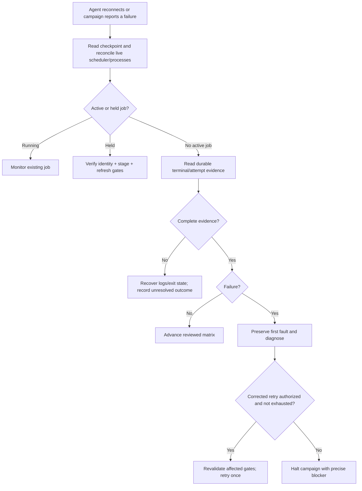

# Acceptance evidence and recovery

Return to [README](../README.md) or [agent handoff](../agent_exemplar_skills.md). Acceptance is specific to the selected hardware, source release, workload matrix and authorization scope.

## Preparation acceptance

| Gate | Required evidence | Failure handling |
| --- | --- | --- |
| Input/support | Complete private inputs and supported source/model/dtype/scale/GPU tuple | Resolve input or compatibility before dependent install/launch |
| Identity | Approved access, trusted host identity and consistent runtime UID/GID | Repair through approved access provisioning |
| Scheduler | Intended account/partition/GRES, affinity/PMIx, authenticated services, no competing campaign | Preserve state; diagnose configuration/resource issue |
| Storage | Persistent bytes/inodes, ownership and shared backing or every node-local receipt | Stage/size correctly before execution |
| Artifact integrity | Pinned source, registry digest/local image hash, exact transferred manifest | Reject mismatched payload and preserve evidence |
| Container | Correct architecture, GPU/NIC visibility, hooks, mounts and environment imports | Resolve host/runtime/library integration |
| Model/data | Exact authorized cache/data closure and offline access if required | Obtain missing approved content |
| GPU/power | Current whole-cohort count/error/temperature/power and required PSU coverage | Diagnose actual fault; do not reset or waive automatically |
| Rendezvous/fabric | Reachability and full approved device/port/provider inventory | Diagnose platform network configuration |
| Communication | Every intended rank and expected rail/provider represented with logs and exit status | Halt launch; investigate omissions/fallback/errors |
| Experiment staging | Generated files verified at all actual recipients | Keep held job held; resolve mapping/delivery |

Readiness evidence must include UTC observation time, cohort identity, configuration/source/image identity, tool versions, result and evidence location. Revalidation is necessary after configuration/cohort/boot/artifact changes. A timestamp edited to look recent is invalid evidence.

## Execution acceptance

For every requested tuple/repeat, retain scheduler ID, generated recipe/config/scripts, runtime image/mount/environment evidence without secrets, actual rank/node/GPU count, per-rank/stdout/batch logs, durable terminal state/exit code and parsed performance metrics. An empty scheduler queue is not a terminal success record.

Record attempts individually and identify the latest valid outcome for each tuple/repeat. If any required tuple lacks complete successful execution evidence, report the campaign as incomplete. Keep failed attempts and first-fault analysis.

## Result categories

| Category | Permitted claim |
| --- | --- |
| Inputs valid | The local input file passed structural checks |
| Artifact verified | Payload matched a trusted recorded inventory |
| Prepared | All applicable preparation/readiness gates passed for the selected target |
| Recipe executed | A supported tuple completed with complete execution evidence |
| Diagnostic result | A labeled exploratory/adapted or supported non-qualification run produced measured results |
| Qualification pending | Required official suite/scoring evidence is prepared for the applicable review |
| Qualified/certified | Only the result established through the relevant official process |

Do not turn a lower-scale result into a larger-scale qualification claim. Compare matching GPU/release/workload/model/dtype/scale and scoring windows. Metric units matter: modeled TFLOPS per GPU is not utilization percent. Keep clocks/temperature/transport evidence with timing results so comparisons can be evaluated.

## Recovery workflow



Lock/checkpoint recovery must be reconciled against real jobs; do not remove a lock solely because its creator's session is gone. Do not cancel unrelated allocations or release an unverified held job. If accounting is unavailable, retain durable batch exit markers and all relevant node/rank outputs.

## Troubleshooting evidence requirements

- **Authentication:** report tool error/status, secret file presence/mode and repository/registry approval status; redact values.
- **Container/runtime:** include architecture/version, scheduler launch context, hooks/mount/device results and first relevant error.
- **Communication:** include actual rendezvous, selected inventory, container transport configuration and missing/failed ranks. Share actual addresses only in private evidence.
- **Health:** include time/coverage and current faults separately from historical counters. Missing telemetry requires equivalent reviewed evidence or an explicit blocker.
- **Performance:** include scoring window, baseline provenance, topology, transport, workload parallelism and step statistics.

Before sharing, inspect environment and runtime diagnostic outputs for secrets and private inventory. Collect relevant bounded evidence, not arbitrary home directories or full secret/config dumps.

## Final checkpoint template

```text
Campaign alias / UTC timestamp:
Authorized objective and scope:
Pinned source and release:
Installed versions and artifact manifest:
Selected workload matrix and cohort:
Preparation gates completed / evidence index:
Active or held scheduler IDs:
Terminal outcomes and retry history:
Observed metrics and interpretation:
Credential provisioning status (paths only):
Current blockers and exact missing inputs:
Next safe action:
```
